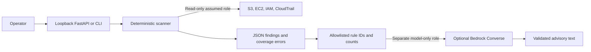

# CloudSentinel AI architecture

The operator selects one AWS account by assuming a dedicated role through a local AWS profile. S3 bucket inventory is account-wide, IAM is account-global, and EC2 and CloudTrail are evaluated in explicitly selected regions. The API starts in synthetic demo mode and uses server-side configuration for live access. Run it on loopback with a trusted local operator. Any shared deployment needs authenticated ingress, authorization, request quotas and protected report storage.

Each finding represents one rule and resource. Its stable ID is a hash of that tuple. Severity and remediation are assigned by code. API failures produce coverage errors and mark the report partial. An empty partial report cannot establish compliance. The scanner retains no historical state. Bucket names and resource IDs can appear in local reports, so protect them as inventory data.

The analyzer receives rule IDs, fixed descriptions and capped aggregate counts. Account IDs, resource names, policy documents, tags, IP addresses, exception strings and operator prompts are outside that projection. The inference role can invoke one regional foundation model. The model has no tools and cannot update findings or AWS resources. Validate the advisory response against a bounded JSON schema and keep it separate from the scan results.

Terraform manages trusted role assumption, scan permissions, optional model access and optional monthly budget notifications. No schedule or public endpoint is provisioned in this milestone. Budget notifications are delayed alerts and spending can continue after an alert. Analysis is explicit, limited to one non-retried inference per report, with bounded input and output. Review model availability, pricing and account logging settings before enabling it.

## Implementation phases

| Phase | Scope | Acceptance |
| --- | --- | --- |
| 1. Foundation | Local package, synthetic demo, scoped IAM and optional budget | Demo works offline and IAM policies map to scan API calls |
| 2. Detection | Paginated inventory, ten deterministic controls and coverage reporting | Fixtures and SDK stubs cover positive, negative and incomplete inventory |
| 3. Analysis | Redaction by projection, separate role, bounded advisory output | Fake model verifies payload contents and rejects malformed output |
| 4. Cloud pilot | After approval, provision roles and budget, then verify live scan and model access in a development account | Compare report with known safe configurations and record permissions and usage |
| 5. History and dashboard | Add DynamoDB with retention, authenticated API, scheduled Lambda and dashboard | Verify partial scans cannot close findings, use idempotent run IDs, enforce retention and invocation limits |
| 6. Portfolio validation | Measure detection accuracy and advisory quality, publish a sanitized demo, design approval-gated remediation | Separate writer role, explicit approval bound to a proposed diff, audit trail and rollback plan |

The current scaffold covers phases 1–3 locally. Scope excludes effective S3 public reachability, route and workload reachability, IAM privilege analysis, and full CloudTrail coverage across organization trails or regions outside the scan. Each check describes the configuration it actually inspects.

## References

- [S3 Block Public Access permissions and effective settings](https://docs.aws.amazon.com/AmazonS3/latest/userguide/configuring-block-public-access-bucket.html)
- [IAM account summary](https://docs.aws.amazon.com/boto3/latest/reference/services/iam/client/get_account_summary.html)
- [Bedrock inference permissions](https://docs.aws.amazon.com/bedrock/latest/userguide/inference.html)
